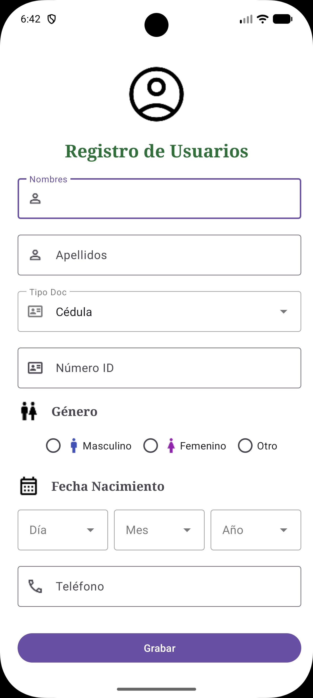

# Práctica 2 - Danna

Esta práctica consiste en el diseño de una aplicación Android que presenta un **formulario de registro de usuarios**, donde se pueden ingresar diferentes datos personales. La interfaz fue desarrollada en **XML**, utilizando `ConstraintLayout` y `ScrollView` para organizar los elementos y permitir que el usuario pueda desplazarse por el formulario.

El objetivo de esta actividad es poner en práctica el uso de componentes visuales de Android Studio, como campos de texto, listas desplegables, botones de selección e imágenes, para crear una interfaz ordenada y fácil de utilizar.

## Capturas de pantalla

  

## Características

La aplicación cuenta con una pantalla de registro que incluye los siguientes elementos:

- **Registro de usuarios:** pantalla principal que muestra un ícono de usuario y el título del formulario.
- **Nombres y apellidos:** campos de texto que permiten ingresar los datos personales del usuario.
- **Tipo de documento:** lista desplegable con las opciones de cédula, pasaporte y RUC.
- **Número de identificación:** campo numérico para ingresar el número del documento.
- **Género:** grupo de botones que permite seleccionar entre Masculino, Femenino u Otro.
- **Fecha de nacimiento:** tres listas desplegables para escoger el día, mes y año.
- **Teléfono:** campo destinado al ingreso del número de contacto.
- **Botón Grabar:** elemento visual ubicado al final del formulario.
- **Diseño:** se utilizaron componentes de Material Design con bordes de estilo `OutlinedBox`, íconos PNG relacionados con cada campo y un fondo claro con detalles en verde.

## Detalles técnicos

- **Entorno de desarrollo:** Android Studio.
- **Lenguaje de programación:** Java.
- **Diseño de interfaz:** XML.
- **Distribución de elementos:** `ConstraintLayout` para organizar los componentes y `ScrollView` para permitir el desplazamiento vertical.
- **Componentes utilizados:** `ImageView`, `TextView`, `TextInputLayout`, `TextInputEditText`, `AutoCompleteTextView`, `RadioGroup`, `RadioButton`, `LinearLayout` y `Button`.
- **Actividad principal:** `registrodeusuario.java`.
- **Archivo de diseño:** `activity_registrodeusuario.xml`.
- **Recursos gráficos:** íconos e imágenes PNG almacenados en la carpeta `res/drawable`.
- **Listas desplegables:** opciones de documentos y fechas definidas mediante `string-array` en `strings.xml`.
- **Configuración:** `AndroidManifest.xml` para establecer la actividad principal y Gradle para administrar las dependencias del proyecto.

